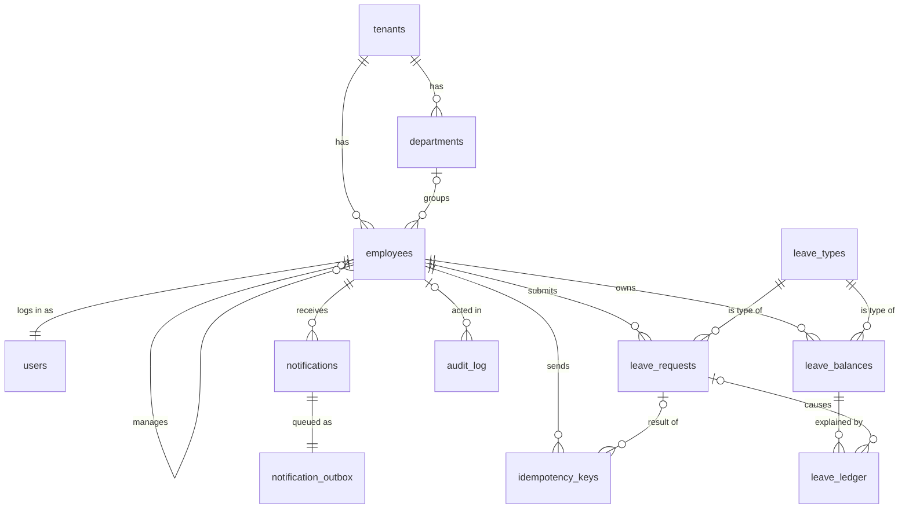

# LeaveDesk — Database Schema (Capstone 3)

**Version:** 1.4 · **Builds on:** SPEC.md v1.3, API_SPEC.md v1.1 · **Database:** PostgreSQL 17 · **Author:** Rithu

This document explains what the database stores, which rules the database itself enforces,
and why each design choice was made. The SQLAlchemy models (`leavedesk/db/models.py`) and the
Alembic revisions (`migrations/versions/`) must match it; when they differ, this file is updated
in the same pull request.

---

## 1. Principles

| # | Principle | What it means here |
|---|---|---|
| P1 | The database enforces the rules it can | Dates, statuses, balances, overlaps and uniqueness are constraints, not only Python checks. A bug in the app cannot store bad data. |
| P2 | Every business table carries `tenant_id` | Every query filters by tenant; tenant-scoped uniqueness (`UNIQUE (tenant_id, …)`). Capstone 3 runs one tenant, `T-DEMO`, set by the `TENANT_ID` setting. |
| P3 | Money-like numbers are exact | Day counts use `numeric(5,1)`, never `float`. |
| P4 | Time is stored with its time zone | Every timestamp is `timestamptz` (stored as UTC). |
| P5 | History is never rewritten | `leave_ledger` and `audit_log` are append-only. |
| P6 | Schema changes only through Alembic | No `create_all()` in the app. Anything the ORM cannot express (EXCLUDE, pg_trgm, triggers, grants) is written in the revision with `op.execute`. |
| P7 | Least privilege | Migrations run as `leavedesk_migrator`; the app runs as `leavedesk_app`, which cannot change the schema. |

---

## 2. Design decisions (Capstone 3, Part A.2)

### 2.1 Keys: identity, not UUIDv7

**Decision:** every table's primary key is `id bigint GENERATED ALWAYS AS IDENTITY`
(`smallint` for the small `leave_types` lookup). Tables whose rows the API exposes also have a
`public_id text` column (`E-ANA`, `LR-1a2b3c4d`, `N-9f8e7d6c`) with `UNIQUE (tenant_id, public_id)`.
The API only ever shows `public_id`; foreign keys always use the internal `id`.

| Option | For | Against | Verdict |
|---|---|---|---|
| **Identity (`bigint`)** | 8 bytes; new rows go to the end of the B-tree (good cache use, little page splitting); cheap joins and foreign keys; built into PostgreSQL | Sequential numbers are guessable, so they must not be shown to users | **Chosen**, with `public_id` for the outside world |
| UUIDv7 | Time-ordered like identity, and can be generated anywhere without asking the database | 16 bytes in every key and foreign key; PostgreSQL 17 has no `uuidv7()` function (it arrives in 18) and Python 3.12 has no `uuid.uuid7()` (it arrives in 3.14), so we would need our own generator | Good choice for distributed systems; not needed for one database |
| UUIDv4 | Unguessable | Random order: every insert lands on a random B-tree page (page splits, poor cache use) | Rejected |

**Why `GENERATED ALWAYS` and not `serial`:** `ALWAYS` stops code from inserting its own ids by
accident, and identity columns are the SQL-standard replacement for `serial`.

**Why keep `public_id`:** the Day 2 API and its tests already use these ids. Keeping them as a
separate column means the API is unchanged and internal numbers are never exposed. `public_id` is
generated by the domain (`LR-` + 8 random hex characters), so it is safe to show.

### 2.2 Leave type, status and role: lookup table vs ENUM vs CHECK

| Column | Choice | Why |
|---|---|---|
| Leave type | **Lookup table** `leave_types` (`code`, `name`, `default_entitlement`, `max_days_per_request`) | Leave types carry their own data (entitlement, limits) and a company could add one (for example `PARENTAL`) by inserting a row, without a migration. A foreign key keeps every request pointing at a real type. |
| Request status | **CHECK** `status IN ('pending','approved','rejected','cancelled')` on `text` | The set is fixed by the state machine in the code (SPEC BR-6); a new status would need new code anyway. A CHECK is easy to change in a migration, unlike a PostgreSQL ENUM, whose values cannot be removed or reordered without recreating the type. |
| Employee role | **CHECK** `role IN ('employee','manager')` | Same reasoning as status. |
| Notification event, outbox status, ledger entry type | **CHECK** | Same reasoning. |

**Why not ENUM:** an ENUM saves a few bytes per row, but adding values needs `ALTER TYPE` (which
cannot run inside a transaction block on older versions) and removing one means rebuilding the type.

### 2.3 `numeric(5,1)` for days

- Half days must be exact: `0.1 + 0.2` in `float` is `0.30000000000000004`; in `numeric` it is `0.3`.
- `(5,1)` = up to 9999.9 days with one decimal place, enough for half days (`0.5`) with room to spare.
- A CHECK also forces whole or half days: `days * 2 = trunc(days * 2)`.
- Not `money`: it is for currency and depends on the `lc_monetary` locale setting.
- Python side: SQLAlchemy `Numeric(5, 1, asdecimal=True)` maps to the domain's `Decimal`.

### 2.4 `timestamptz` for audit columns

- `timestamptz` stores an exact moment (converted to UTC); `timestamp` stores a wall-clock reading
  with no zone, so "10:00" from Coimbatore and "10:00" from New Jersey would look identical.
- Every `created_at`, `updated_at`, `read_at`, `locked_until`, `sent_at` is `timestamptz NOT NULL DEFAULT now()`
  (or nullable where "not yet" is meaningful, such as `read_at`).
- Leave dates themselves are `date`: a day of leave is a calendar day, not a moment.

### 2.5 Text columns

`text` with CHECK length limits instead of `varchar(n)`: in PostgreSQL they perform the same, and a
CHECK states the business rule (reason 10–500 characters) in one visible place. `char(n)` is never used
(it pads with spaces).

### 2.6 Balance stored and ledger kept (Capstone 3, Part A.5)

`leave_balances` holds the current figures so a balance can be read and **locked** (`FOR UPDATE`) as
one row. `leave_ledger` records every movement. Rule: for each employee and leave type,

```text
entitlement = SUM(entitlement_delta)   used = SUM(used_delta)   pending = SUM(pending_delta)
```

The repository writes the ledger row and the balance update in the same transaction, so they cannot
drift apart; a test (DB-9) checks the equality after a mixed sequence of actions.

---

## 3. Entity relationship diagram



---

## 4. Tables

Common columns are written once: `id` is the identity primary key; `tenant_id bigint NOT NULL
REFERENCES tenants(id)`; `created_at timestamptz NOT NULL DEFAULT now()`.

### 4.1 `tenants`
| Column | Type | Rules |
|---|---|---|
| `id` | bigint identity | PK |
| `public_id` | text | NOT NULL, UNIQUE (`T-DEMO`) |
| `name` | text | NOT NULL, 1–200 characters |
| `created_at` | timestamptz | NOT NULL, default `now()` |

### 4.2 `departments`
| Column | Type | Rules |
|---|---|---|
| `id`, `tenant_id`, `created_at` | | common |
| `name` | text | NOT NULL, 1–100 characters; `UNIQUE (tenant_id, name)` |

### 4.3 `employees`
| Column | Type | Rules |
|---|---|---|
| `id`, `tenant_id`, `created_at` | | common |
| `public_id` | text | NOT NULL; `UNIQUE (tenant_id, public_id)` |
| `department_id` | bigint | NULL, FK `departments(id)` |
| `manager_id` | bigint | NULL, FK `employees(id)`; CHECK `manager_id <> id` |
| `name` | text | NOT NULL, 1–100 characters |
| `email` | text | NOT NULL; **unique per tenant, case-insensitive**: `UNIQUE INDEX (tenant_id, lower(email))` |
| `role` | text | NOT NULL, CHECK `role IN ('employee','manager')` |

### 4.4 `users` (login accounts)
| Column | Type | Rules |
|---|---|---|
| `id`, `tenant_id`, `created_at` | | common |
| `employee_id` | bigint | NOT NULL, FK `employees(id)`, UNIQUE (one login per employee) |
| `password_hash` | text | NOT NULL, CHECK `password_hash LIKE '$argon2id$%'` |
| `failed_login_count` | integer | NOT NULL default 0, CHECK `>= 0` |
| `locked_until` | timestamptz | NULL (not locked) |
| `last_login_at` | timestamptz | NULL |

The email lives on `employees`; login finds the employee by `(tenant_id, lower(email))`, then its user row.

### 4.5 `leave_types` (lookup, shared by all tenants)
| Column | Type | Rules |
|---|---|---|
| `id` | smallint identity | PK |
| `code` | text | NOT NULL, UNIQUE, CHECK `code ~ '^[A-Z_]{2,20}$'` |
| `name` | text | NOT NULL |
| `default_entitlement` | numeric(5,1) | NOT NULL, CHECK `>= 0` |
| `max_days_per_request` | numeric(5,1) | NULL (no limit) |

Seeded in the first revision: `ANNUAL 18`, `SICK 12`, `CASUAL 6 (max 2)`. This is reference data, not
tenant data, so it has no `tenant_id` (the one deliberate exception to P2).

### 4.6 `leave_requests`
| Column | Type | Rules |
|---|---|---|
| `id`, `tenant_id`, `created_at` | | common |
| `public_id` | text | NOT NULL; `UNIQUE (tenant_id, public_id)` |
| `employee_id` | bigint | NOT NULL, FK `employees(id)` |
| `leave_type_id` | smallint | NOT NULL, FK `leave_types(id)` |
| `start_date`, `end_date` | date | NOT NULL; **CHECK `end_date >= start_date`** |
| `half_day` | boolean | NOT NULL default false; CHECK `NOT half_day OR start_date = end_date` |
| `reason` | text | NOT NULL, CHECK `char_length(reason) BETWEEN 10 AND 500` |
| `status` | text | NOT NULL default `'pending'`, CHECK in the four statuses |
| `days` | numeric(5,1) | NOT NULL, CHECK `days >= 0.5 AND days * 2 = trunc(days * 2)` |
| `decided_by` | bigint | NULL, FK `employees(id)` |
| `decision_note` | text | NULL; CHECK `status <> 'rejected' OR decision_note IS NOT NULL` |
| `updated_at` | timestamptz | NOT NULL default `now()` |
| `version` | integer | NOT NULL default 1 — SQLAlchemy `version_id_col` (optimistic locking) |

**Overlap rule in the database (Part A.4):**

```sql
CREATE EXTENSION IF NOT EXISTS btree_gist;

ALTER TABLE leave_requests ADD CONSTRAINT leave_requests_no_overlap
  EXCLUDE USING gist (
    tenant_id   WITH =,
    employee_id WITH =,
    daterange(start_date, end_date, '[]') WITH &&
  ) WHERE (status IN ('pending', 'approved'));
```

- `daterange(..., '[]')` includes both end dates, matching SPEC BR-5.
- `btree_gist` lets a GiST index compare plain `=` columns alongside the range `&&` (overlaps) operator.
- The `WHERE` clause means rejected and cancelled requests never block new ones.
- Violations raise SQLSTATE `23P01`; the repository turns that into `OverlappingLeaveError` (409).
- Why it is needed when Python already checks: two requests submitted at the same moment both pass the
  Python check before either is saved. Only the database sees both (DB-7).

### 4.7 `leave_balances`
| Column | Type | Rules |
|---|---|---|
| `id`, `tenant_id` | | common |
| `employee_id` | bigint | NOT NULL, FK `employees(id)` |
| `leave_type_id` | smallint | NOT NULL, FK `leave_types(id)`; `UNIQUE (employee_id, leave_type_id)` |
| `entitlement`, `used`, `pending` | numeric(5,1) | NOT NULL, each CHECK `>= 0`; CHECK `used + pending <= entitlement` |
| `updated_at` | timestamptz | NOT NULL |
| `version` | integer | NOT NULL default 1 — `version_id_col` |

The CHECK `used + pending <= entitlement` is the database's last line of defence for "available can
never become negative" (BR-4).

### 4.8 `leave_ledger` (append-only)
| Column | Type | Rules |
|---|---|---|
| `id`, `tenant_id`, `created_at` | | common |
| `employee_id` | bigint | NOT NULL, FK `employees(id)` |
| `leave_type_id` | smallint | NOT NULL, FK `leave_types(id)` |
| `leave_request_id` | bigint | NULL (grants have no request), FK `leave_requests(id)` |
| `entry_type` | text | NOT NULL, CHECK in `('grant','reserve','confirm','release')` |
| `entitlement_delta`, `used_delta`, `pending_delta` | numeric(5,1) | NOT NULL default 0 |

| Action (BR-4) | `entry_type` | Deltas |
|---|---|---|
| Register employee | `grant` | entitlement +N |
| Apply | `reserve` | pending +days |
| Approve | `confirm` | pending −days, used +days |
| Reject or cancel | `release` | pending −days |

**Append-only is enforced twice:** the app role is granted only `SELECT, INSERT`; and a
`BEFORE UPDATE OR DELETE` trigger raises an error, so even the migration role cannot rewrite history
by mistake. Corrections are new rows, never edits. Row triggers do not fire on `TRUNCATE`; the app
role has no `TRUNCATE` privilege, so only the schema owner (migrator) could empty the table, which the
test suite does on purpose to reset the test database.

### 4.9 `audit_log` (append-only)
| Column | Type | Rules |
|---|---|---|
| `id`, `tenant_id`, `created_at` | | common |
| `actor_employee_id` | bigint | NULL (system actions), FK `employees(id)` |
| `action` | text | NOT NULL (`leave.apply`, `leave.approve`, `auth.lockout`, …) |
| `entity_type`, `entity_public_id` | text | NULL |
| `details` | jsonb | NOT NULL default `'{}'` — never contains passwords or tokens |

Written in the same transaction as the change it describes, so a rolled-back action leaves no audit
row. Failed attempts are still logged to the application log by `@audit`. Same append-only protection
as the ledger.

### 4.10 `notifications`
| Column | Type | Rules |
|---|---|---|
| `id`, `tenant_id`, `created_at` | | common |
| `public_id` | text | NOT NULL; `UNIQUE (tenant_id, public_id)` |
| `recipient_id` | bigint | NOT NULL, FK `employees(id)` |
| `event` | text | NOT NULL, CHECK in `('submitted','approved','rejected','cancelled')` |
| `message` | text | NOT NULL |
| `payload` | jsonb | NOT NULL default `'{}'` (request id, dates, leave type) |
| `read_at` | timestamptz | NULL = unread |

**Partial index on unread rows per recipient (Part C2):**

```sql
CREATE INDEX ix_notifications_unread
  ON notifications (tenant_id, recipient_id, created_at DESC)
  WHERE read_at IS NULL;
```

It only contains unread rows, so it stays small however many old notifications pile up, and it
serves both "unread first" and the `?unread=true` filter. The domain's `read` flag is `read_at IS NOT NULL`.

**Why `jsonb`, not `json`:** `jsonb` is stored parsed, can be indexed and compared; `json` keeps the
original text, which we never need.

### 4.11 `notification_outbox` (Part C2)
| Column | Type | Rules |
|---|---|---|
| `id`, `tenant_id`, `created_at` | | common |
| `notification_id` | bigint | NOT NULL, FK `notifications(id)`, UNIQUE |
| `status` | text | NOT NULL default `'pending'`, CHECK in `('pending','sent','failed')` |
| `attempts` | integer | NOT NULL default 0, CHECK `>= 0` |
| `available_at` | timestamptz | NOT NULL default `now()` (retry back-off) |
| `sent_at` | timestamptz | NULL |
| `last_error` | text | NULL |

```sql
CREATE INDEX ix_outbox_pending ON notification_outbox (available_at, id) WHERE status = 'pending';
```

**Flow:** the notification row and its outbox row are inserted in the **same transaction** as the leave
change. If that transaction rolls back, neither exists (DB-23). A sender claims rows with
`FOR UPDATE SKIP LOCKED`, so two senders never send the same row (DB-24). An `AFTER INSERT` trigger on
`notifications` calls `pg_notify('leavedesk_notifications', '{"id": <public_id>, "tenant_id": <id>}')`;
PostgreSQL delivers NOTIFY messages only when the transaction commits, so a rolled-back change never
wakes the SSE stream (DB-23, DB-25). Senders: the API's background task right after each response, and
the worker (`python -m leavedesk.worker`) for anything left over. Delivery is at-least-once; after 5
failed attempts (back-off 2, 4, 8, 16 s) a row is marked `failed` (DB-26).

### 4.12 `idempotency_keys` (Part C)
| Column | Type | Rules |
|---|---|---|
| `id`, `tenant_id`, `created_at` | | common |
| `employee_id` | bigint | NOT NULL, FK `employees(id)` |
| `key` | text | NOT NULL, CHECK `char_length(key) BETWEEN 1 AND 255`; `UNIQUE (tenant_id, employee_id, key)` |
| `request_hash` | text | NOT NULL (SHA-256 of the canonical request body) |
| `leave_request_id` | bigint | NULL, FK `leave_requests(id)` |
| `response_status` | smallint | NOT NULL |
| `response_body` | jsonb | NOT NULL |

The key row is inserted in the same transaction as the new request. A failed request rolls back and
stores nothing, so the client can retry with the same key. Two requests with the same key at the same
moment are serialised with a transaction-level **advisory lock** on the key
(`pg_advisory_xact_lock(hashtextextended('idempotency:<tenant>:<employee>:<key>', 0))`): it locks a
number, not a row, so it works before the row exists; the second request waits, then finds the stored
response (DB-21). Rows older than 24 hours may be deleted by a cleanup job (out of scope).

---

## 5. Indexes

### 5.1 Foreign key indexes (Part A.3)

PostgreSQL indexes the referenced side (the primary key) automatically but **not** the referencing
column. Without an index, deleting a parent row or joining from parent to children scans the whole
child table. Every foreign key column therefore gets an index in revision 0001, unless an index that
starts with that column already exists (for example the `UNIQUE (employee_id, leave_type_id)` on
`leave_balances` covers `employee_id`).

| Table | Column | Covered by |
|---|---|---|
| all tenant tables | `tenant_id` | `ix_<table>_tenant_id` (or a UNIQUE starting with `tenant_id`) |
| `employees` | `department_id`, `manager_id` | `ix_employees_department_id`, `ix_employees_manager_id` |
| `users` | `employee_id` | its UNIQUE constraint |
| `leave_requests` | `employee_id`, `leave_type_id`, `decided_by` | `ix_leave_requests_employee_id` (replaced in 0003 by the history index, which starts with `employee_id`; see 5.2), `…_leave_type_id`, `…_decided_by` |
| `leave_balances` | `employee_id`, `leave_type_id` | UNIQUE `(employee_id, leave_type_id)`, `ix_leave_balances_leave_type_id` |
| `leave_ledger` | `employee_id`, `leave_type_id`, `leave_request_id` | one index each |
| `audit_log` | `actor_employee_id` | `ix_audit_log_actor_employee_id` |
| `notifications` | `recipient_id` | `ix_notifications_recipient_id` |
| `notification_outbox` | `notification_id` | its UNIQUE constraint |
| `idempotency_keys` | `employee_id`, `leave_request_id` | UNIQUE `(tenant_id, employee_id, key)` does **not** start with `employee_id`, so `ix_idempotency_keys_employee_id` too; `ix_idempotency_keys_leave_request_id` |

A test (DB-30) queries `pg_constraint` and `pg_index` and fails if any foreign key column lacks an index.

### 5.2 Query indexes (Part B, revision 0003, proven in PERF.md)

| Query | Index | Kind | Column order explained |
|---|---|---|---|
| Manager's pending queue (pending requests of the manager's direct reports, oldest start first) | `ix_leave_requests_pending (employee_id, start_date, id) WHERE status = 'pending'` | **Partial** + composite | Only pending rows are stored, a small slice of 100k, so the index stays small. Equality column first (`employee_id`, matched against the manager's reports), then the sort columns, so each report's rows come out already ordered. |
| An employee's history (newest first, keyset pages) | `ix_leave_requests_history (employee_id, start_date DESC, id DESC)` | **Composite** | Equality column first (`employee_id`), then the sort column (`start_date`), then `id` as the tie-breaker that makes keyset pagination exact. Putting `start_date` first would scan every employee's rows in the date range. `tenant_id` is left out on purpose: `employee_id` is a globally unique bigint, so it already implies the tenant, and a leading `tenant_id` would only widen the index. (`tenant_id` does lead where the key alone is not unique across tenants, such as `public_id` and `lower(email)`.) |
| Employee name search (`name ILIKE '%ana%'`) | `ix_employees_name_trgm gin (name gin_trgm_ops)` | **pg_trgm GIN** | A B-tree can only use a fixed prefix (`'ana%'`); a leading wildcard needs trigram matching. |
| The request list in its default order, and keyset pagination | `ix_leave_requests_start_date_id (start_date, id)` | Composite | The list's sort order; `id` makes the order total, so a `(start_date, id)` cursor names exactly one position. |

Because `ix_leave_requests_history` starts with `employee_id`, it also covers that foreign key, so
revision 0003 drops the now-redundant single-column `ix_leave_requests_employee_id` (every extra
index slows down every insert and update).

**How PERF.md proves each index (Done when):** `scripts/perf.py` captures the "before" plans at revision
0002, with the 100k seed loaded and `ANALYZE` run. The foreign key index on `leave_requests.employee_id`
and the GiST index behind the EXCLUDE constraint (which `btree_gist` lets serve `employee_id = …`) would
otherwise stand in, so the "before" plan runs inside
`BEGIN; DROP INDEX …; ALTER TABLE … DROP CONSTRAINT …; EXPLAIN (ANALYZE, BUFFERS) …; ROLLBACK;`
DDL in PostgreSQL is transactional, so nothing is really dropped, but the plan shows what the query
costs with no supporting index. Then 0003 is applied and the "after" plans are captured.

Query indexes are not created `CONCURRENTLY` inside Alembic (that cannot run inside a transaction);
on a live production table we would use `CREATE INDEX CONCURRENTLY` in a non-transactional revision.

---

## 6. Roles and privileges (Part D)

| Role | Login | Owns | Rights | Used by |
|---|---|---|---|---|
| `leavedesk` | yes | the database | superuser (Docker image default) | the init script only |
| `leavedesk_migrator` | yes | the `public` schema and every table | all, including DDL | Alembic |
| `leavedesk_app` | yes | nothing | `CONNECT`; `USAGE` on the schema; `SELECT, INSERT, UPDATE, DELETE` on tables, except `SELECT, INSERT` only on `leave_ledger` and `audit_log`; `USAGE` on sequences; **no `CREATE`** | the API and the worker |

**How the grants are made:** `docker/postgres-init/01-roles.sh` creates both roles, the
`leavedesk_test` database and, in each database, `ALTER DEFAULT PRIVILEGES FOR ROLE leavedesk_migrator`,
so every table a revision creates is automatically usable by the app role. A revision only has to take
rights *away* (revision 0001 revokes `UPDATE, DELETE` on the two append-only tables). Passwords come
from `MIGRATOR_PASSWORD` and `APP_PASSWORD` in `.env`. The script runs only when the data volume is
empty (`docker compose down -v` to run it again).

App-role session settings (`ALTER ROLE leavedesk_app SET …`), so a stuck query or lock cannot hang a request:

| Setting | Value | Effect |
|---|---|---|
| `statement_timeout` | `5s` | A query running longer is cancelled (SQLSTATE `57014`) |
| `lock_timeout` | `2s` | Waiting longer for a row lock fails (SQLSTATE `55P03`) |
| `idle_in_transaction_session_timeout` | `10s` | A transaction left open by a bug is closed, so it cannot block VACUUM |

The API turns `57014` and `55P03` into 503 `DATABASE_BUSY` with a `Retry-After` header (API_SPEC 5).

Stretch: a row-level security policy `USING (tenant_id = current_setting('app.tenant_id')::bigint)` on
tenant tables, with the app setting `app.tenant_id` at the start of each transaction.

---

## 7. Transactions and locking

| Rule | Detail |
|---|---|
| Isolation | `READ COMMITTED` (PostgreSQL default). Races are handled with row locks and constraints, so no serialization-failure retries are needed. |
| One transaction per request | Every write endpoint runs in one transaction that commits before the response is sent, or rolls back completely. |
| Pessimistic locking | Approve, reject and cancel lock the request row, then the balance row, with `SELECT … FOR UPDATE`. Apply locks the balance row. |
| Lock order | Always request first, then balance. Every code path takes locks in the same order, so two transactions cannot wait on each other in a circle (deadlock, `40P01`). |
| Optimistic locking | `version` columns via SQLAlchemy `version_id_col`: an `UPDATE … WHERE id = :id AND version = :seen` that matches no row raises `StaleDataError`, returned as 409 `CONCURRENT_UPDATE`. Clients can also send `If-Match: <version>`. |
| Queries | ORM `select()` or `text()` with bound parameters only; never string formatting. |

---

## 8. Migrations

| Revision | Branch / PR | Contents |
|---|---|---|
| `0001_initial_schema` | `feature/db-infra` | Extensions (`btree_gist`), tables 4.1–4.10, constraints, EXCLUDE, FK indexes, unread partial index, append-only triggers, revoke `UPDATE, DELETE` on the append-only tables, seed tenant `T-DEMO`, department `Engineering` and the three leave types |
| `0002_notification_outbox` | `feature/db-notifications` | Table 4.11, outbox index, `pg_notify` trigger on `notifications` |
| `0003_query_indexes` | `feature/perf` | `pg_trgm` extension, the four indexes in 5.2, drop the redundant `ix_leave_requests_employee_id` |
| `0004_idempotency_keys` | `feature/idempotency` | Table 4.12 |

Every revision has a working `downgrade()`; DB-3 checks `upgrade head → downgrade base → upgrade head`.

---

## 9. Schema review checklist

| Check | Where |
|---|---|
| Every table has a primary key | Section 4 |
| Every business table has `tenant_id NOT NULL` with an FK | P2, section 4 |
| Required columns are `NOT NULL` | Section 4 |
| Day counts are `numeric(5,1)`; timestamps are `timestamptz` | 2.3, 2.4 |
| Dates checked (`end_date >= start_date`), half day checked | 4.6 |
| Email unique per tenant, case-insensitive | 4.3 |
| Overlap blocked by EXCLUDE | 4.6 |
| Every FK column indexed | 5.1, DB-30 |
| Ledger and audit log append-only | 4.8, 4.9 |
| App role has no DDL; timeouts set | 6 |
| No secrets in migrations (role passwords come from environment variables) | 6, init script |

---

## 10. Change log

| Version | Date | Change |
|---|---|---|
| 1.0 | 2026-11-16 | Initial schema for Capstone 3 |
| 1.1 | 2026-11-16 | Section 6: grants come from default privileges set by the init script, revisions only revoke; 4.8: TRUNCATE note; section 8: revision 0001 contents updated to match the code. |
| 1.2 | 2026-11-16 | Outbox built before idempotency, so revisions renumbered (0002 outbox, 0003 idempotency keys); 4.11 describes the real NOTIFY payload, the two senders and the retry policy, and cites the correct SPEC criteria (DB-23 to DB-26). |
| 1.3 | 2026-11-16 | Query indexes are revision 0003 (built before idempotency); fourth index `(start_date, id)` for the list order and keyset pagination; the PERF.md method also drops the EXCLUDE constraint inside the rolled-back transaction, because its GiST index can serve `employee_id = …`. |
| 1.4 | 2026-11-16 | 4.12: concurrent submits with the same key are serialised with an advisory lock; revision 0004 built. |
